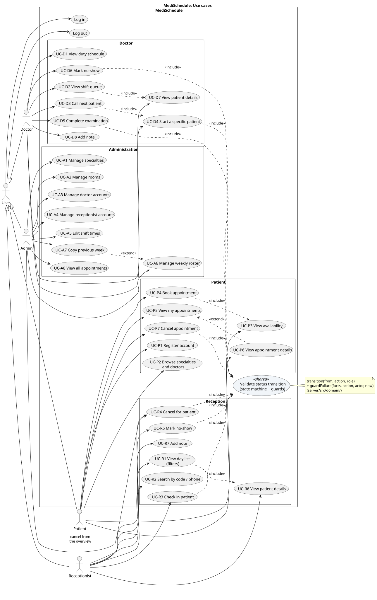
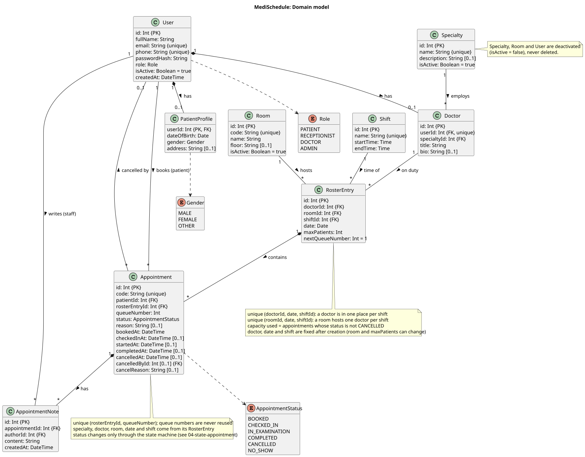
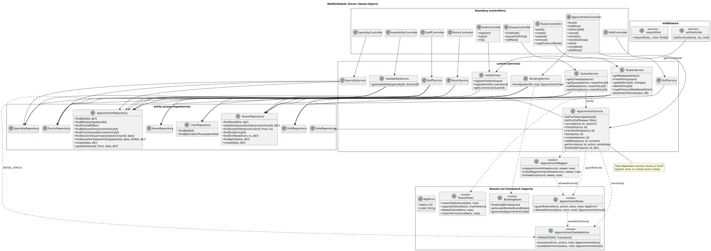
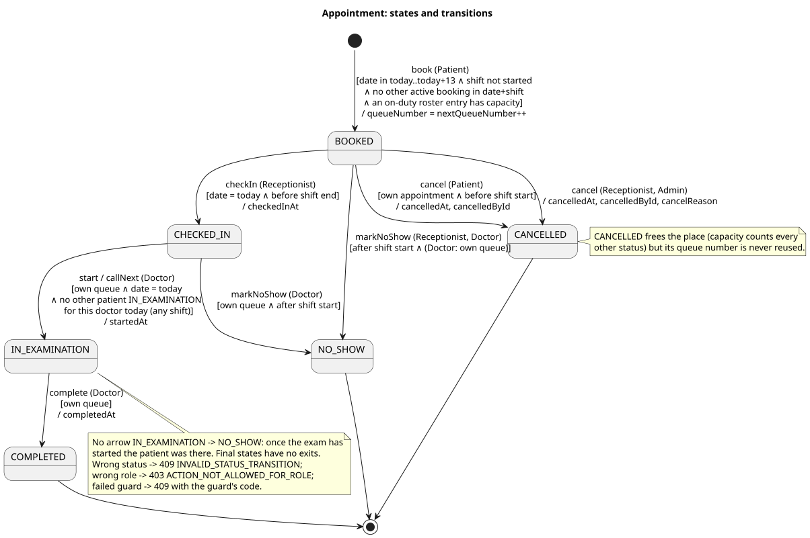
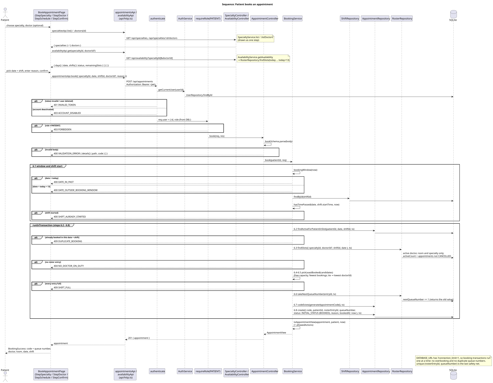
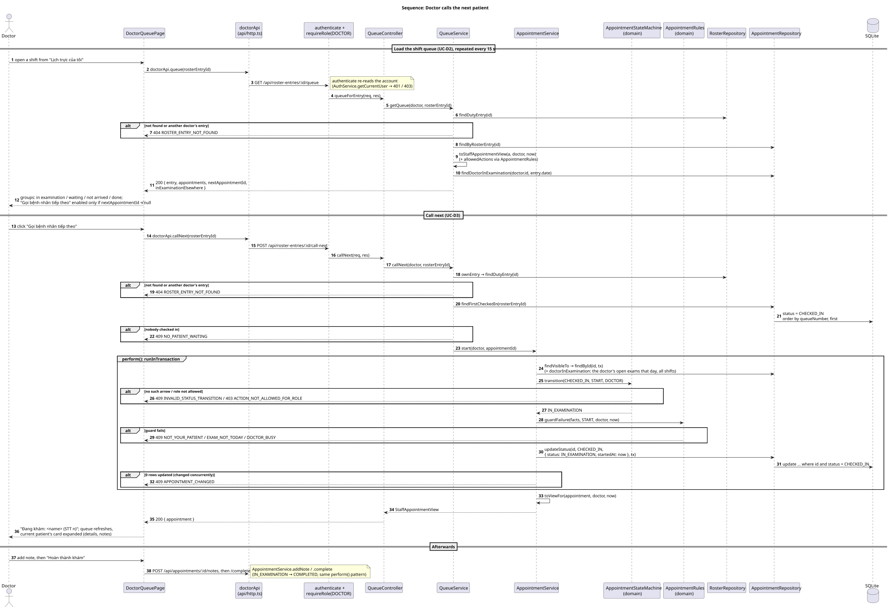
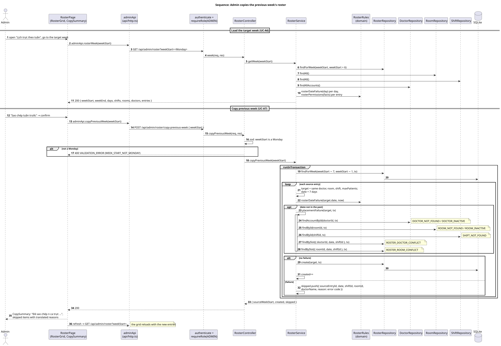

# MediSchedule

Appointment booking for a multi-specialty clinic, built for a Software Analysis & Design course. The code is laid out so each part matches a UML diagram (use case, class, state, sequence); see [UML diagrams](#uml-diagrams).

**Roles:** Patient · Receptionist · Doctor · Admin
**Stack:** React + Vite + Tailwind (client) · Express + Prisma + SQLite (server) · JWT auth · TypeScript throughout
**Target:** desktop web browsers, 1280px wide and up. Mobile and responsive layouts are out of scope.

## Getting started

Requires Node.js 20+ (developed on 24 LTS).

```bash
npm install                          # installs server + client (npm workspaces)
cp server/.env.example server/.env   # skip if server/.env already exists
npm run db:setup                     # create prisma/dev.db, apply migrations, seed demo data
npm run dev                          # API on :4000, web app on http://localhost:5173
```

> npm 11+ asks before running dependency install scripts. Prisma and esbuild need theirs. They are pre-approved under `allowScripts` in `package.json`. If Prisma complains about missing engines, run `npm rebuild prisma @prisma/engines @prisma/client esbuild`.

### Demo accounts

Every seeded account uses the password **`password123`**. In development, the login page lists them and fills them in when you click one.

| Role         | Login                                                        |
| ------------ | ------------------------------------------------------------ |
| Admin        | `admin@medischedule.local`                                   |
| Receptionist | `reception1@medischedule.local`, `reception2@…`              |
| Doctor       | `doctor1@medischedule.local` … `doctor6@…` (2 per specialty) |
| Patient      | `patient1@example.com` … `patient3@…`                        |

The seed creates a duty roster for **this week and next** (Mon–Sat, Morning 07:30–11:30 / Afternoon 13:00–17:00) and two bookings for the first doctor's next morning shift (patients 1 and 2). To roll the dates forward, run `npm run db:seed -w server` again. It wipes and reseeds everything.

### Testing time-based rules at any hour (dev only)

Check-in is allowed only on the appointment day before the shift ends, and no-show only after the shift starts. To try these at night or on a Sunday:

1. `npm run db:seed -w server`, then `npm run db:seed:today -w server`. This fills **today** with morning and afternoon queues for doctor1 (Nội tổng quát) and doctor3 (Nhi khoa): 6 booked, 4 checked in, 1 in examination, 1 completed, 1 cancelled. doctor3's morning is mid-shift. It also adds patients 4–8.
2. Set `DEV_FAKE_NOW="09:00"` in `server/.env` and restart `npm run dev`. The server then acts as if it were 09:00 today, and the app shows an amber banner. Try `06:00`, `09:00`, `12:00` and `18:00` to see check-in and no-show appear and disappear. The expected buttons are listed in `.claude/docs/date_logic.md`.
3. Set `DEV_FAKE_NOW=""` and restart to go back to the real clock. The setting is refused when `NODE_ENV=production`, and tests ignore it.

## Language conventions

- **UI text is Vietnamese.** Code, identifiers, API routes and database values stay English.
- **The server returns error codes, not user text.** Errors look like `{ code: "SHIFT_FULL", message: "<English, for developers>" }`, and validation errors carry per-field codes: `details: [{ path: "email", code: "EMAIL_INVALID" }]`. Zod schemas use codes as their messages (`server/src/validation.ts`).
- **The client translates codes** in one place, `client/src/i18n/errors.ts`. Enum values get Vietnamese labels in `client/src/i18n/labels.ts` (for example `BOOKED` → "Đã đặt", `CHECKED_IN` → "Đã check-in", `Morning` → "Ca sáng").
- **Dates are shown as dd/MM/yyyy** (`client/src/lib/date.ts`). The API sends calendar dates as `YYYY-MM-DD`. Date of birth is typed as dd/mm/yyyy and converted before sending.
- **Seed display content** (specialty and room names, people's names) is Vietnamese. Shift names (`Morning`/`Afternoon`) are fixed identifiers that the client translates.

## Scripts

| Command (repo root)               | What it does                                                           |
| --------------------------------- | ---------------------------------------------------------------------- |
| `npm run dev`                     | Run API and client together                                            |
| `npm test`                        | Server tests (Vitest + supertest, against a separate `prisma/test.db`) |
| `npm run typecheck`               | `tsc --noEmit` for server and client                                   |
| `npm run lint` / `npm run format` | ESLint / Prettier                                                      |
| `npm run db:setup`                | Migrate + seed                                                         |
| `npm run db:reset -w server`      | Drop the dev DB, re-run migrations and seed                            |
| `npm run db:studio -w server`     | Browse data in Prisma Studio                                           |

## Architecture

```
Route → Controller → Service → Repository → SQLite (Prisma)
            ↑            ↑           ↑
            └──────── domain/ (enums, errors, state machine, date helpers) ────────┘
```

- **Controller:** HTTP only. Validates input with zod and turns results into JSON.
- **Service:** business rules and transactions. Throws `AppError`s (`domain/errors.ts`).
- **Repository:** the only layer that talks to Prisma.
- **domain/:** plain TypeScript with no framework imports. Every layer can use it.
- Every error response has the shape `{ "error": { "code", "message", "details?" } }` (`middleware/errorHandler.ts`).
- **Time-dependent services take a `Clock`** (`domain/time.ts`), so tests can fix "now" (for example "09:00, the morning shift has started").
- **Booking runs in one transaction** (`db/prisma.ts runInTransaction`). `DATABASE_URL` uses `connection_limit=1`, so concurrent bookings are serialized and can't overbook or repeat a queue number. A test fires 6 bookings at a 3-place shift to check this.

```
server/
  prisma/            schema.prisma (class diagram), migrations/, seed.ts
  src/
    domain/          enums.ts, errors.ts, time.ts, booking.ts, appointmentStateMachine.ts,
                     appointmentRules.ts (guards), rosterRules.ts
    middleware/      authenticate.ts, requireRole.ts, errorHandler.ts
    modules/<area>/  <area>.routes.ts · .controller.ts · .service.ts · .repository.ts
    validation.ts    shared zod pieces (error-code messages)
    app.ts           builds the Express app (used by server.ts and tests)
  tests/             unit, service and HTTP tests; e2e.flow.test.ts = one full day, all roles
client/src/
  api/               fetch wrapper (JWT, ApiError) + one file per resource
  auth/              AuthContext, ProtectedRoute, role → home page
  i18n/              Vietnamese labels and error-code messages
  lib/date.ts        dd/MM/yyyy formatting and parsing
  hooks/             useApi (load + refresh + optional polling), useSubmit (one mutation)
  components/        Layout, ErrorBoundary, LoadError, AppointmentCard, StaffActions, CancelAppointment,
                     PatientInfo, AppointmentNotes, StatusBadge, RefreshButton, EmptyState, ui/…
  pages/             auth/, patient/ (+ booking/ wizard), reception/, doctor/, admin/ (+ roster/)
docs/uml/            PlantUML sources for the diagrams; svg/ holds the rendered images (see "UML diagrams" below)
```

### API

| Method & path                                                                                                                   | Role                         | Use case     |
| ------------------------------------------------------------------------------------------------------------------------------- | ---------------------------- | ------------ |
| `POST /api/auth/register`, `POST /api/auth/login`                                                                               | public                       | UC-P1, login |
| `GET /api/auth/me`                                                                                                              | any                          | session      |
| `GET /api/specialties`, `/:id/doctors`                                                                                          | any                          | UC-P2        |
| `GET /api/availability?specialtyId&doctorId?`                                                                                   | any                          | UC-P3        |
| `POST /api/appointments`                                                                                                        | Patient                      | UC-P4        |
| `GET /api/appointments/mine`                                                                                                    | Patient                      | UC-P5/P6     |
| `POST /api/appointments/:id/cancel`                                                                                             | Patient, Receptionist, Admin | UC-P7/R4     |
| `GET /api/appointments?date&shiftId&specialtyId&doctorId&status&q`                                                              | Receptionist, Admin          | UC-R1/R2     |
| `POST /api/appointments/:id/check-in`                                                                                           | Receptionist                 | UC-R3        |
| `POST /api/appointments/:id/no-show`                                                                                            | Receptionist, Doctor         | UC-R5/D6     |
| `POST /api/appointments/:id/notes`                                                                                              | Receptionist, Doctor         | UC-R7/D8     |
| `GET /api/shifts`                                                                                                               | any                          | filters      |
| `/api/admin/specialties`, `/rooms`, `/doctors`, `/receptionists` (list, create, `PATCH`, `POST …/:id/activate`, `…/deactivate`) | Admin                        | UC-A1–A4     |
| `PATCH /api/admin/shifts/:id`                                                                                                   | Admin                        | UC-A5        |
| `GET /api/admin/roster?weekStart`, `POST/PATCH/DELETE /api/admin/roster-entries[/:id]`                                          | Admin                        | UC-A6        |
| `POST /api/admin/roster/copy-previous-week`                                                                                     | Admin                        | UC-A7        |
| `GET /api/doctor/schedule`                                                                                                      | Doctor                       | UC-D1        |
| `GET /api/roster-entries/:id/queue`                                                                                             | Doctor (own shift)           | UC-D2        |
| `POST /api/roster-entries/:id/call-next`                                                                                        | Doctor (own shift)           | UC-D3        |
| `POST /api/appointments/:id/start`                                                                                              | Doctor (own shift)           | UC-D4        |
| `POST /api/appointments/:id/complete`                                                                                           | Doctor (own shift)           | UC-D5        |

Doctors only see and act on appointments in their own shifts. Each doctor examines one patient at a time, across all their shifts that day.

Every appointment in a response carries `allowedActions`: what the current user can do with it right now, according to the state machine and the shift times. The UI shows only those buttons.

`GET /api/availability` returns the **whole 14-day booking window** in one response (each day → shifts → places left), not a single date as the original sequence diagram said. The wizard can then gray out full or closed days without one request per day. In the "patient books" sequence diagram, step 3 becomes `GET /availability?specialtyId[&doctorId]`.

## Design → code map

Each diagram in `docs/uml/` maps to code as follows. The step-by-step tables (every use case → endpoint → service method, and every sequence message → method) are in `.claude/docs/design_mapping.md`.

| Diagram                                          | Element                                                  | Code                                                                                                                                                         |
| ------------------------------------------------ | -------------------------------------------------------- | ------------------------------------------------------------------------------------------------------------------------------------------------------------ |
| Use cases (`01-use-cases.puml`)                  | each use case                                            | one route + controller method + service method (e.g. UC-P4 → `POST /api/appointments` → `AppointmentController.book` → `BookingService.book`)                |
|                                                  | actors                                                   | `authenticate` + `requireRole(...)` on each route; `Role` in `server/src/domain/enums.ts`                                                                    |
|                                                  | «include» "validate status transition"                   | `transition()` + `guardFailure()` (`server/src/domain/`)                                                                                                     |
| Domain classes (`02-class-domain.puml`)          | entities, attributes, multiplicities, unique constraints | `server/prisma/schema.prisma`                                                                                                                                |
|                                                  | enumerations                                             | `server/src/domain/enums.ts`, `AppointmentAction` in `appointmentStateMachine.ts`                                                                            |
| Layered classes (`03-class-architecture.puml`)   | boundary / control / entity-access classes               | `*Controller`, `*Service`, `*Repository` in `server/src/modules/**` (one singleton each, constructor injection)                                              |
|                                                  | domain modules                                           | `appointmentStateMachine.ts`, `appointmentRules.ts`, `booking.ts`, `rosterRules.ts`                                                                          |
| Appointment states (`04-state-appointment.puml`) | each arrow                                               | one row of `TRANSITIONS` (`appointmentStateMachine.ts`) and one `POST /api/appointments/:id/<action>` endpoint                                               |
|                                                  | each `[guard]`                                           | a case of `guardFailure` (`appointmentRules.ts`); the same rules produce `allowedActions` in every response                                                  |
| Sequence: patient books (`05-…`)                 | steps 6.1–6.8                                            | `BookingService.book` (`server/src/modules/appointments/booking.service.ts`, steps numbered in comments), inside `runInTransaction`                          |
| Sequence: doctor calls next (`06-…`)             | call next → start                                        | `QueueService.callNext` → `AppointmentRepository.findFirstCheckedIn` → `AppointmentService.start` → `perform` (`transition`, `guardFailure`, `updateStatus`) |
| Sequence: admin copies previous week (`07-…`)    | loop over source entries, skip with reason               | `RosterService.copyPreviousWeek` → `rosterDateFailure` / `placementFailure` → `RosterRepository.create`                                                      |

Tests that keep code and diagrams in step: `appointmentStateMachine.test.ts` (every arrow, every forbidden move), `appointmentRules.test.ts` (guard boundaries), `booking.service.test.ts`, `queue.service.test.ts` and `roster.service.test.ts` (sequence rules with fixed clocks), and `e2e.flow.test.ts` (one full clinic day through the HTTP API, all four roles, real logins).

## UML diagrams

PlantUML sources live in `docs/uml/`, and the rendered images in `docs/uml/svg/` (open an SVG on GitHub or in a browser to zoom in):

| Diagram                                                       | Source                                                                            | Image                                                                               |
| ------------------------------------------------------------- | --------------------------------------------------------------------------------- | ----------------------------------------------------------------------------------- |
| Use cases per actor                                           | [01-use-cases.puml](docs/uml/01-use-cases.puml)                                   | [01-use-cases.svg](docs/uml/svg/01-use-cases.svg)                                   |
| Domain model (entities, enumerations, constraints)            | [02-class-domain.puml](docs/uml/02-class-domain.puml)                             | [02-class-domain.svg](docs/uml/svg/02-class-domain.svg)                             |
| Server classes by layer (controllers, services, repositories) | [03-class-architecture.puml](docs/uml/03-class-architecture.puml)                 | [03-class-architecture.svg](docs/uml/svg/03-class-architecture.svg)                 |
| Appointment state machine with guards                         | [04-state-appointment.puml](docs/uml/04-state-appointment.puml)                   | [04-state-appointment.svg](docs/uml/svg/04-state-appointment.svg)                   |
| Sequence: patient books an appointment                        | [05-sequence-patient-books.puml](docs/uml/05-sequence-patient-books.puml)         | [05-sequence-patient-books.svg](docs/uml/svg/05-sequence-patient-books.svg)         |
| Sequence: doctor calls the next patient                       | [06-sequence-doctor-calls-next.puml](docs/uml/06-sequence-doctor-calls-next.puml) | [06-sequence-doctor-calls-next.svg](docs/uml/svg/06-sequence-doctor-calls-next.svg) |
| Sequence: admin copies the previous week's roster             | [07-sequence-admin-copies-week.puml](docs/uml/07-sequence-admin-copies-week.puml) | [07-sequence-admin-copies-week.svg](docs/uml/svg/07-sequence-admin-copies-week.svg) |

<details>
<summary>Use cases</summary>



</details>

<details>
<summary>Domain model</summary>



</details>

<details>
<summary>Server classes by layer</summary>



</details>

<details>
<summary>Appointment states</summary>



</details>

<details>
<summary>Sequence: patient books an appointment</summary>



</details>

<details>
<summary>Sequence: doctor calls the next patient</summary>



</details>

<details>
<summary>Sequence: admin copies the previous week's roster</summary>



</details>

### Reading the diagrams

- **Use cases:** an actor linked to a use case can perform it. `«include»` means the use case always runs the other one (booking always shows availability); `«extend»` means an optional addition (copying the previous week extends the roster editor). Codes such as `UC-P4` match the API table above.
- **Domain model:** each class is a table in `schema.prisma`. `{PK}`, `{FK}`, `{unique}` mark keys, `[0..1]` marks an optional field, the numbers at line ends are multiplicities, and a filled diamond means the part belongs to the whole (an appointment to its roster entry).
- **Server classes:** packages go top to bottom from controllers to services, repositories and the framework-free domain. A solid arrow is a constructor dependency; a dashed arrow is a call into a domain module.
- **Appointment states:** each arrow reads `action (roles) [guard] / effect` and is one row of `TRANSITIONS` plus one `POST /api/appointments/:id/<action>` endpoint. Moves that aren't drawn are rejected.
- **Sequences:** read top to bottom, left (user) to right (database). Solid arrows are calls, dashed arrows are replies; `alt` boxes are the error branches with their HTTP status and error code, `group runInTransaction` is one database transaction.

### Re-rendering

After editing a `.puml` file, re-export the SVGs so the images stay in step with the sources. With Java 17+ and the [PlantUML jar](https://plantuml.com/download):

```bash
java -jar plantuml.jar -Playout=smetana -charset UTF-8 -tsvg -o svg docs/uml/*.puml
```

`-Playout=smetana` uses PlantUML's built-in layout engine, so Graphviz isn't needed (the committed images were made this way). `-o svg` is relative to each source, so the files land in `docs/uml/svg/` named after their source. For a quick preview, use the VS Code "PlantUML" extension (Alt+D). Renderers that send the source to a server (such as the public PlantUML server) work too, if you don't mind uploading the diagram text.

## Known limitations

- **A booked shift can't be reassigned to another doctor.** A roster entry's doctor, date and shift are fixed after creation, and a doctor's specialty is fixed, because appointments get their doctor and specialty through the entry. Admins can move the entry to another room, change `maxPatients`, or cancel the bookings.
- **Desktop only.** Built for 1280px-wide browsers and up. There is no mobile or tablet layout.
- **No real-time updates.** Screens refresh by polling (doctor queue every 15 s, reception list and doctor schedule every 30 s) and with the "Làm mới" button. A change made by someone else can take that long to appear.
- **No notifications.** Patients get no email, SMS or push message for booking confirmations, reminders, or cancellations made by the clinic.
- **No profile editing (UC-P8) and no password change or reset.** Admins can set a new password for staff accounts. Patients can't change theirs yet.
- **Sessions are a single 8-hour JWT** stored in `localStorage`, with no refresh token. Logging out only forgets the token on that browser. A deactivated account is still blocked immediately, because every request re-checks the account.
- **Reception can't book for a patient.** Walk-ins must register and book themselves.
- **No rescheduling.** A patient cancels and books again, and gets a new queue number.
- **Fixed shifts.** There are exactly two shifts (Morning, Afternoon). Admins can change their times, and the change applies to bookings already made.
- **One clinic, one timezone, SQLite.** Dates and times are local strings, and `connection_limit=1` serializes writes. That suits one clinic, but not many concurrent users.
- **Tests cover the server only.** The client has no automated tests.

## Future work

- Reassign a booked shift to another doctor of the same specialty (move the roster entry's doctor, notify the affected patients, and record who made the change).
- Responsive layout for phones and tablets, starting with the patient booking wizard and "Lịch hẹn của tôi".
- Real-time queue and list updates (Server-Sent Events or WebSockets) in place of polling.
- Notifications: booking confirmation, day-before reminder, and messages when the clinic cancels or a shift changes (email/SMS).
- Patient profile and password management (UC-P8), and password reset by email.
- Reception booking on behalf of a patient (walk-ins, phone bookings) and rescheduling.
- Refresh tokens / server-side sessions, and an audit log of staff actions.
- Client component tests and browser end-to-end tests (e.g. Playwright).

## Status

- [x] **Phase 0:** scaffolding (workspaces, Express, Vite, Tailwind, Prisma, ESLint/Prettier, Vitest)
- [x] **Phase 1:** data model, seed data, patient registration, login (email or phone), JWT, role-based routing
- [x] **Vietnamese UI:** error codes from the server, translations in the client, dd/MM/yyyy dates
- [x] **Phase 2:** patient booking (availability, booking wizard, my appointments, cancel), appointment state machine
- [x] **Phase 3:** reception (day list with filters, search, check-in, cancel, no-show, notes, patient details)
- [x] **Phase 4:** doctor queue (duty schedule, shift queue, call next, start, complete, no-show, notes, polling)
- [x] **Phase 5:** admin management (specialties, rooms, doctor/receptionist accounts, shift times, weekly roster editor + copy previous week, all-appointments overview)
- [x] **Phase 6:** polish (retryable error and empty states, error boundary, session-ended message), end-to-end API test across all four roles, PlantUML diagrams, design → code map, known limitations
